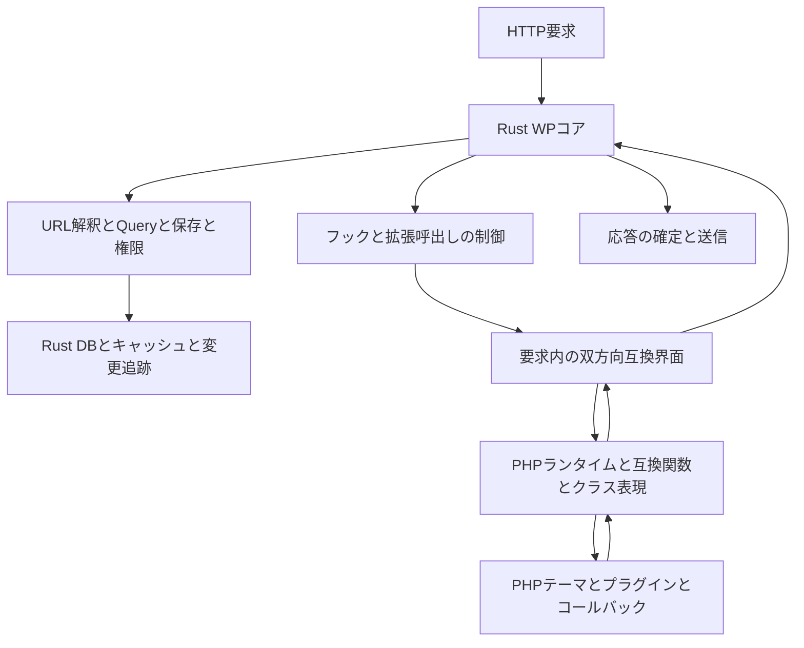

# WPコアのRust移植とPHP互換界面の検討

作成日：2026-11-09 日本時間  
対象：現在の `dev/v0.5` の成果物と、ローカルに固定されたWordPress 7.1.3の参照ソース  
状態：議論用の単独検討文書。採用済み仕様ではない。

本書は、WPコア全体のRust移植という元の目的を出発点として、PHPテーマ・プラグインを利用するために、どこへPHPコードとPHPランタイムを残すべきかを検討する。ユーザーが示した「移植が少量にとどまるとPHP-Wasmへの適応作業で終わり、プロジェクトの面白さが減る」という問題意識を、性能とは別の製品・技術上の評価軸として扱う。

**推奨する到達像は、WPの要求処理・クエリー・保存・権限・標準コンテンツ処理をRustへ移し、PHPには既存拡張の実行、PHP言語の値とオブジェクト、WP互換の関数・クラスの表面を残す構成である。** HTTP、DB接続、キャッシュだけのRust化を到達点にはしない。PHP互換界面は単純なJSON APIより複雑になるが、その困難をWPコア移植の中心課題として正面から扱う。

これは「既存WPを起動してRustが周囲を管理する構成」から、「RustコアがPHP拡張を呼び出す構成」への転換を提案するものである。成立済みと主張するものではない。特に、PHPから見える公開プロパティ、参照、グローバル変数、コールバックからの再入は、既存PoCでは全面的に成立していない。

本書以外の仕様、README、対応台帳、実装、既存証跡は変更しない。実験・性能測定も実行していない。以下では、確認した事実、そこからの推論、提案を区別する。

## 1 検討の前提と目標

### 1.1 元の目的と今回の位置付け

旧設計のR02はWordPressコアのPHPからRustへの移植、R04はRustを唯一の本番CMSコアとしPHP版WordPressコアを本番に残さない要求である。[旧設計の決定事項](../design.ja.md#2-決定事項と製品の目的)

一方、2026-11-01のv0.5案は、WPのURL解釈、クエリー生成、保存フック、認証判断などを初期段階ではPHPへ残す。Git上では、その内容は `963d3e8` に存在し、Rust上でPHPを動かす最初のv0.5実験 `e4cd484` より先に記録されている。PoCが全面移植の不成立を実証した結果ではない。[v0.5案](2026-11-01-rust-wp-server/README.ja.md)

今回のユーザー指示は、元の全面移植の意図を踏まえた詳細検討と、本書一つの作成を許可するものである。これを新方式の採用、旧要件すべての復活、実装開始の承認として扱わない。特に「WPコアをRustへ移すこと」と「PHPテーマを利用者がRustへ変換すること」「公開要求からPHPを一切実行しないこと」は別の選択である。

### 1.2 何をRust化したと呼ぶか

本書では、次の四つを分ける。

| 段階 | Rustが担う内容 | WPコア移植としての評価 |
| --- | --- | --- |
| 実行基盤 | HTTP、PHP実行監督、DB接続、ファイル能力、資源管理 | 必要な土台。ただし、これだけではWPのRust移植とは言いにくい |
| 処理の一部 | 整形、検索の一部、キャッシュ、限定的な計算 | 部分移植。全要求の制御がPHPに残る場合がある |
| CMSの意味と制御 | URLをどう解釈し、何を検索し、誰が何を保存でき、どのフックをどの順に呼ぶか | コア移植の中心。プロジェクトの主たる到達点に置く |
| PHPコードの全面除去 | コアだけでなくテーマ、プラグイン、同梱ライブラリ等のPHPもなくす | 別の目標。既存PHP資産の実行と同時には成立しない |

推奨は三段目を広く完成させることである。PHPランタイムやPHP形式のクラス宣言が残ることを理由に、コアの意味のRust移植まで断念する必要はない。逆に、PHPクラスを残したまま主要な分岐・SQL生成・保存手順まで従来どおり実行するなら、名称だけをRustコアへ変えても実質は変わらない。

### 1.3 全体移植の完了条件を曖昧にしない

長期目標としての「WPコア全体」は、公開閲覧だけでなく、投稿・分類・メタデータ・ユーザー・権限・REST・管理操作・cron・標準ブロック・メディア・更新や移行の意味を含む。初回の正式対象を単一サイトに絞ることは可能だが、マルチサイトなどの未移植分は残件として明記する。

最終的にPHPへ残す候補は、互換宣言、値・オブジェクトの表現、拡張の実行、言語ランタイムへの接続である。管理画面や標準ブロックの複雑なPHP実装を、理由なく「界面」と呼び替えて恒久的に除外しない。

PHP製の同梱外部ライブラリ、管理画面のHTML生成、PHPランタイム自体についても区分を明示する。外部ライブラリを残す構成は「WP独自の業務ロジックの移植」とは両立するが、「配布物からコア由来のPHPファイルをすべて除去」とは同じではない。どちらを達成したかは別々に報告する。

## 2 現在の成果物から分かること

### 2.1 コードと証跡の現在地

| 成果物 | 確認したこと | 本書での評価と限界 |
| --- | --- | --- |
| `recastpress-wp` と対応台帳 | 79 API、WP_Hookとnamed dispatcherの2コンポーネントを追跡 | 再利用できる実装・比較基盤がある。いずれも対象領域を限定した実験実装 |
| PHP値モデル | byte string、順序付き配列、整数等を表現 | オブジェクト・PHP参照・resource全般を扱う互換ランタイムではない |
| 従来のAPI比較 | 正式79 API・519,014比較などの完了履歴がある | 後続Cookie照合取り込み後の全体再検証は未完了。過去の成功を現在source全体の保証へ転用しない |
| PHP-WasmとRust HTTP | 両DBでhome／404／反復404が通常PHPの応答と一致。module compileはsession中1回 | 比較基準として有用。任意要求、拡張、管理操作全体の互換性を証明しない |
| wpdb接続 | 標準API、更新ヘルパー、raw errorなどの固定比較 | SQLの実行基盤を再利用できる。WPのクエリー・保存判断までRust化したものではない |
| Rust要求内キャッシュ | 固定2グループ、56観測が一致 | オブジェクトなどは元のPHP実装を使う。全キャッシュの移植ではない |
| autoload共有とbinlog | 標準SELECTのSQL省略、COMMIT失効、位置不一致時のDB直読を固定条件で確認 | キャッシュ基盤の価値を示す。`get_option()`／`update_option()`全体の意味の移植ではない |
| PHP/Wasmの資源・異常系 | 線形memory、演算予算、失敗後の回復等を固定条件で確認 | PHP拡張実行層として価値がある。全RSS、全hostcall、取消し等は残件 |

出典：[対応台帳](../../compatibility/registry.json)、[互換実装の検証履歴](../compatibility-development.ja.md)、[v0.5の進捗](../v0.5-development.ja.md)、[値モデル](../../crates/recastpress-wp/src/value.rs)、[Rustキャッシュ実験](../../experiments/wp-object-cache-rust-probe/README.ja.md)。

### 2.2 PHPファイル数の扱い

固定参照のmanifestを集計すると、`.php` は全1,512ファイル、`wp-content/` を除くと1,315ファイルで、内訳はルート14、`wp-admin/` 242、`wp-includes/` 1,059である。これは同梱ライブラリや補助ファイルも含む配置上の数え方であり、1,315個が独立した移植作業になる意味ではない。

対応台帳の79 APIと2コンポーネントの直接の出典は11ファイルである。11÷1,315は約0.84％だが、「そのファイルの一部を扱った割合」にすぎない。データテーブル参照等の全依存を数えた値でもない。本書では、この値から移植工数、必要期間、完成率を推定しない。[inventory](../../compatibility/inventory-summary.json)

### 2.3 PoCへの投資は移植方針と両立する

既存のPHP-Wasm経路は、比較用の元WP、PHP拡張を実行する将来の層、DB・キャッシュ・資源管理の接続検証という三つの用途へ再利用できる。全面移植へ進むときも、すべて廃棄する必要はない。

ただし、元WPの `wp-settings.php` を丸ごと起動する実行経路を、そのまま最終構成として固定すると、PHPがWPの主導権を持ち続ける。参照系として保存する経路と、移植を進める製品経路は役割を分ける必要がある。

**これまでのPoCはPHP再利用の成立を示しているが、Rustコア移植の不可能性も、性能上の不利も示していない。** 移植を優先する判断は、元の製品目標と新しい境界の成立性に基づいて行うべきである。

## 3 PHPとの境界に関する構成案の比較

| 案 | Rustの責務 | PHPへ残るもの | 魅力 | 主な負担 | 本書の評価 |
| --- | --- | --- | --- | --- | --- |
| A 実行基盤をRust化 | HTTP、DB、cache、監督 | WPコアのほぼ全体と拡張 | 既存WPの意味を再利用できる | PHP/Wasmへの適応が中心になる | 現在地・比較基準として有用。元の移植目標の到達点にはしない |
| B 重い処理だけRust化 | Aに加え一部計算や索引 | 要求制御・業務判断の大部分 | 効果を絞って改善しやすい | 小さな置換ではコア移植へ進まない | 移行途中の手段。恒久方針にするとユーザーの懸念が残る |
| C CMSコアをRust化しPHP互換界面を残す | 要求・query・保存・権限・標準処理・フックの実行順序 | 拡張コード、PHP値とcallable、WP APIの互換表面 | 元の目標と既存PHP拡張を両立する余地がある | オブジェクト・参照・再入を扱う大きな互換課題 | 推奨する到達像。最も重要な未実証点を先に調べる |
| D 公開系Rustと管理系WPを分割 | 公開query・描画等 | 管理・保存を含むPHP版WP | 公開経路を先行して移せる | 同じAPI・権限・cacheを二重に維持しやすい | 期間を限った移行案。最終的に管理側も同じRustコアへ寄せる |
| E PHP資産もRustへ移す | コアに加え拡張のロジックもRust | 原則としてPHPを使わない | 構造は最も統一できる | 既存拡張の変換・再実装が利用条件になる | 別の製品方針。コア移植の再優先から自動的に採用しない |

C案は「少量のRust化で済ませる案」ではない。WPの標準機能を広く移し、PHPが担当するものを言語互換と拡張の実行へ収束させる。逆に、C案にしても任意のPHPコードを無条件に動かせる保証にはならない。

D案では、同じ関数名でも公開側と管理側で意味が異なる状態を長期化させない。例えば公開でRust版 `get_option()`、管理でPHP版 `update_option()` を使う間も、共有cacheの失効、値のcodec、hooksの順序を合わせる必要がある。公開／管理のプロセス分離と、業務コアの二重実装は別の論点である。

## 4 推奨する境界

### 4.1 コアの判断と拡張コードの実行の間に置く

境界は「WP本体対テーマ・プラグイン」を基本とする。ただし、関数・クラス名の宣言やPHPオブジェクトの表現は、WP本体に由来するものでもPHP側に必要となる。



図は論理責務を示す。Rust hostから実行中のWasmへ任意に再入できる実装を既に持つ、という意味ではない。実際の呼出しは第8章の継続・再入方式で成立させる必要がある。

### 4.2 Rustへ置くもの

Rustへ移す中心は、WP標準の状態遷移と処理規則である。

- 起動段階、登録順序、標準フック、要求終了の制御。
- URL・rewrite・query vars・条件判定、WP_Queryの検索手順とSQL構築。
- 投稿・分類・メタデータ・オプション・ユーザー・コメントの標準読取りと更新。
- 認証、権限、セッション、nonce、公開・非公開の判断。ただしPHP拡張からの変更点を保つ。
- テンプレート階層と選択、Loopの制御、標準コンテンツ変換、標準ブロックの処理。
- RESTのルート解決・標準controller、cron、メール等の標準手順、管理操作の判断。
- DB接続・共有cache・変更追跡・資源配分・HTTPと運用機構。

「SQL実行はRust、SQLをどう作るかは常にPHP」「保存はRust、保存前後のWPの手順は常にPHP」という分割では、本書の到達点には達しない。

### 4.3 PHPへ恒久的に残せるもの

| 領域 | PHPに残す責務 | PHPに残したままでは移植済みと数えないもの |
| --- | --- | --- |
| 既存テーマ・プラグイン | PHPコードをそのまま実行する | WP標準のquery・保存・認可を全部委譲すること |
| PHP値 | zval、配列の参照、object identity、closure、例外等の言語動作 | WP固有の分岐・標準アルゴリズム全体 |
| WP互換関数 | 元の名前・引数・既定値・参照指定・返値や出力の形を提供する入口 | 呼出し先が元PHP実装のままの関数 |
| WP互換クラス | class identity、公開プロパティ、継承、magic method等を表現する | WP_Queryなどの標準ロジックをそのまま保持すること |
| 拡張callbackの実行 | callableの解決、実行、PHP状態の観測、例外・出力の取得 | 標準callbackの全実装を恒久的にPHPへ残すこと |
| 言語標準機能 | PHP値のcast、PHP serializer、拡張ライブラリの実行等の必要な言語機能 | 業務判断を「言語互換」の名目で無制限に残すこと |

界面の薄さはPHPファイルの行数だけでは測れない。PHPに多くの宣言が必要でも、コアの判断がRustに移っていれば意味がある。一方、短いPHPラッパーが元WP全体のbootstrapを呼ぶなら、意味の移植量は小さい。

### 4.4 一時的に残すものは出口を持つ

管理画面のPHP描画、未移植の標準ブロック、メディア処理などを移行中に再利用することは現実的である。ただし、それぞれに「残す理由」「呼出し範囲」「置換後の責務」「完了の確認方法」を設ける。

未移植の標準ロジックを実行する経路は、互換界面と区別して「PHP標準処理への委譲」と表示する。最終段階まで残るなら、その部分について全面移植は未完了とする。性能改善が小さくても、全体移植という目的のために後段で移す選択は正当なものとして残す。

## 5 WPの分野ごとの移植境界

| 分野と主な参照ファイル | Rustへ移す規則 | PHP側の表面と実行 | 主要な難所 | 優先度の考え方 |
| --- | --- | --- | --- | --- |
| bootstrap `wp-settings.php` | 読込み段階、標準登録、初期化順 | pluginとthemeのinclude、定数・globalの公開 | MU plugin、通常plugin、pluggable、親子themeの順序 | 最初から境界設計が必要。元bootstrapの恒久利用を避ける |
| hooks `plugin.php`、`WP_Hook` | 順序、優先度、反復・再入、標準hookの発火 | callable、公開callbacks、PHP参照 | `all`、実行中変更、直接書換え | 高。全分野の成立条件になる |
| query `WP`、`WP_Rewrite`、`WP_Query` | 要求解釈、検索条件、SQL、件数、404、Loop | WP_Query等のclassとプロパティ、変更callback | SQL filters、main query、nested Loop、object identity | 高。Rust CMSの最初の象徴的な到達点 |
| post／taxonomy／meta | 取得、整合、保存・削除の手順 | WP_Post等の値、save hooks、拡張登録 | 参照、cache invalidation、複数SQLと途中失敗 | 高。読取りの次に更新を同じコアへ移す |
| options／transients | default、autoload、更新条件、期限、cache順序 | filters、任意PHP値とserializer | falseとmiss、objects、clone、更新中の再入 | 高。ただしscalar限定のまま全面対応としない |
| wpdb | prepare等の標準API、公開状態、DBセッション | `$wpdb` facade、raw結果のPHP表現 | escaping、charset、last_error、独自SQL | 既存PoCを再利用。driver handleの直接互換は既決の除外を維持 |
| 認証・権限・session | principal、role／capability、tokenとnonceの判定 | WP_User表現、認証・権限filters、pluggable callback | 判断の二重化、失効、pluginの変更 | 設計は早期、切替は更新・再入の実証後 |
| templateとLoop | 階層、選択、条件タグ、current post | PHPテンプレートinclude、ローカル変数、出力 | globals、`extract()`、template_include、Loopの復元 | queryと一体で高。HTML生成全体の書換えは後段 |
| formatting／KSES／i18n | WP固有の整形規則、翻訳選択、escaping | callback、PHPの必要な型変換 | locale、診断、filters、既存subsetの制限 | 既存コードの活用先。全関数数だけを追わない |
| blocks／shortcodes／widgets | 標準parser、registry、context、標準render規則 | 拡張のrender_callback、shortcode・widget実装 | block theme、動的block、nested query、style生成 | 公開機能の重要な残件。classic themeの後へ放置しない |
| REST／AJAX／XML-RPC | 標準ルート、標準controller、権限とschema | plugin endpointとpermission callback、PHP request facade | 任意callback、headers、errors、認証 | 公開と管理の両方に必要。表面ごとに受入れを分ける |
| 管理画面・編集 | 標準操作、validation、保存、権限、menu規則 | 当初はPHP view・plugin admin page、後に互換shellへ縮小 | JS editorとの契約、admin hooks、list table | 後回しにはできるが永久除外はしない |
| media／HTTP／mail | WPの登録・変換指示・通知規則・API契約 | 拡張callback、当初は必要なPHPライブラリ | image library差、失敗、外部副作用 | 基盤と業務判断を分けて段階移植 |
| cron／install／upgrade | schedule、標準job、schema手順、更新状態 | plugin jobとactivation/deactivation callback | 重複、途中失敗、version差、復元 | 本番運用に必須。全体移植の完了条件に含める |
| multisite・非推奨API | 対象版での標準動作 | 互換宣言と拡張callback | site切替、global、旧引数・診断 | 初回対象外なら明記。未移植を達成分へ混ぜない |

この表は分野の判断であり、全APIや全依存を列挙した台帳ではない。新しい全面移植率の分母には使わない。

## 6 最大の難所はPHPから観測できる状態

### 6.1 WPの境界は関数呼出しだけではない

固定ソースの `WP_Query` は `query_vars`、`posts`、`post`、条件フラグなどを公開する。`wp-settings.php` は `$wp_query` と `$wp_the_query` に同じWP_Queryオブジェクトを設定する。`WP_Post` は多数の公開プロパティと動的プロパティを持つ。`WP_Hook` は公開 `callbacks` とIterator／ArrayAccessを持つ。

したがって、以下のようなPHPコードも境界に含まれる。これは実行したテストではなく、検討用の例である。

```php
add_action('pre_get_posts', function ($query) {
    $query->query_vars['posts_per_page'] = 7;
    $query->set('post_type', 'product');
    $other = new WP_Query(['post_type' => 'news']);
});

$GLOBALS['wp_query'] = $custom_query;
$alias = &$query->query_vars;
$alias['orderby'] = 'title';
```

`set()`だけをRustへ転送しても、配列への直接書込みやglobalの置換は捕捉できない。さらにPHPのオブジェクト共有と `&` による変数のaliasは異なるため、IDだけをコピーする仕組みで両方を同じものとして扱えない。[PHP公式 Objects and references](https://www.php.net/manual/en/language.oop5.references.php)

### 6.2 公開プロパティをmagic methodへ変えるだけでは解決しない

PHPの `__get()`／`__set()` は、通常のアクセス可能な公開プロパティの読書きすべてを自動的に横取りする仕組みではない。公開プロパティをprivateに変えると、参照、Reflection、列挙、serialize、継承等からの観測も変わり得る。[PHP公式 Overloading](https://www.php.net/manual/en/language.oop5.overloading.php)

したがって「WP_Queryを薄いproxy classにすれば済む」という工数見積りは採らない。特に `query_vars` のような配列の要素変更を、元と同じPHP配列のまま全件即時監視できるとは仮定しない。

### 6.3 提案する状態の扱い

**業務規則の所有者はRustとし、PHPが直接操作する値の実体はPHPへ残せる**と考える。この二つは同じ意味ではない。すべての可変プロパティの最新コピーを常時Rustにも置く設計は、整合の難しさを増やす。

| 状態 | 正式な保持場所の提案 | 境界で行うこと |
| --- | --- | --- |
| DBの永続値 | WP互換DB | Rustの保存手順を通し、外部更新も追跡する |
| 共有cache、接続、資源予算 | Rust | PHPへ権限の限定されたAPIを公開する |
| PHP object、配列参照、closure | 要求内PHP runtime | 要求世代付きhandleで識別し、必要な値だけをRustへ渡す |
| PHPから直接書けるWP公開状態 | PHP実体を観測上の正本とする案 | Rust処理の入口とcallbackの前後で必要状態を取得・反映する |
| Rust処理中の計算状態 | Rustの要求・操作context | callbackへ渡す前に公開状態へ反映し、戻ったら古いsnapshotを破棄する |
| principalと認可判断 | 一つのRustコア | PHPのcurrent user表現と同期するが、別の独立認証系を作らない |

PHP実体を公開状態の正本とする案でも、検索条件の解釈、SQL生成、結果処理をRustが実行すれば、そのアルゴリズムはRustへ移植されている。PHPへ残るのは互換な可変メモリの表現である。ただし同期費用は発生する。

同期は「callback終了時だけ」では不十分である。callbackが公開値を変更した直後に別のRust APIを呼ぶ場合、そのAPIの入口でも変更を観測しなければならない。nested callback、globalの差替え、同じobjectへの複数alias、途中例外も同じ規則で扱う。

未知の動的プロパティをRustの型へ無理にコピーしない。PHP内で保持し、標準アルゴリズムが必要とする領域を明示して取得する。一方、pluginが標準プロパティを書き換えた影響は、対応対象の範囲で標準アルゴリズムへ反映する。

### 6.4 比較すべき三つの実装手段

| 手段 | 利点 | 難しさ | 扱い |
| --- | --- | --- | --- |
| PHP classと境界ごとの明示同期 | PHPの通常のproperty・object動作を利用できる | 大きな配列の読取り、直接変更の観測、継承と再入 | 最初の成立性確認に向く候補 |
| Zend内部classとobject handler | property操作や値への接続をより細かく設計できる可能性 | PHP ABI、GC、参照、serialize、Wasmビルドへの依存が深い | 同期方式で問題が出た場合の候補。未実証 |
| 互換対象をmethod経由だけに限定 | 構造は単純になる | 標準的な公開状態利用まで切り捨てかねない | 最初から一般解にしない。必要なら互換範囲変更として議論する |

C案が現実的かを分けるのは、この領域の成立性である。既存のscalar／array codecを拡張すれば自然に解決する、と見込まない。

### 6.5 class名だけでなく継承と呼出し先も保つ

PHP側へ同名classを置いて `instanceof` を通すだけでは十分ではない。constructor、公開・protected method、拡張によるoverride、static呼出し、magic method、clone、serializeの契約を扱う必要がある。

例えば拡張がWP_Queryのmethodをoverrideしている場合、元PHPがそのmethodへ仮想呼出しする位置を、移植後だけRust内部の標準実装へ直結すると拡張が呼ばれなくなる。Rustコアは、標準処理へ進む位置とPHPのoverrideを解決する位置を区別し、必要な呼出しを元objectへ戻す設計が必要になる。元classがfinalな場合は、その制約も互換表現へ残す。

Reflectionの全観測まで完全一致させる目標とは分けるが、通常のclass利用と継承を保つためのdispatchは移植対象に含める。この費用も、純粋な関数ラッパーを大量生成するだけでは解決しない。

## 7 フックとコールバックは早期に扱う

### 7.1 Rust側のコアとPHP側の拡張をつなぐ中心機能

WPのactions／filtersは、coreと拡張が相互作用するための基本機構である。[WordPress公式 Hooks](https://developer.wordpress.org/plugins/hooks/)

現在のRust hooksとdispatcherは有用だが、Rust側でモデル化したcallbackと値を中心とする部分実装である。PHP object callback、closure、参照引数、`$wp_filter` の直接操作を全面的に満たすものではない。[現Rustフック](../../crates/recastpress-wp/src/hooks.rs)、[対応台帳の制限](../../compatibility/registry.json)

フックを「移植の最後に付け足す互換層」と考えると、query・保存・権限等の移植後に構造を作り直す危険がある。最初から、Rust処理の途中でPHPを呼び、そのPHPがRustへ戻る経路を想定する。

### 7.2 移行中と到達点を分ける

最初の段階では、元のPHP `WP_Hook` がcallbackと公開状態を保持し、Rustコアが明示した発火点で呼ぶ構成を比較基準にできる。これでもqueryや保存の移植を始められる。ただしフック機構自体は未移植として数える。

到達点では、標準の発火位置と順序、実行frame、反復と変更の規則をRustへ移す。PHP側はcallableの実体、公開 `callbacks` の互換表現、参照引数の実行を担当する。PHP公開callbacksの直接編集とRust実行中の反復がどう整合するかは、独立した成立条件にする。

元WPの標準callbackをRust内部呼出しへ置き換える場合も、`remove_filter()`、`has_filter()`、`all`、実行中の登録変更から観測できる名前と登録を保つ。標準callbackを不可視のRust処理へ畳み込んでしまうと、拡張が外せなくなる。

### 7.3 先に確かめるべき振る舞い

- 同じpriority内の順序、同一callbackの置換、accepted args、0引数。
- object method・static method・closureの識別と解除。
- 再入、`all`、実行中の追加・削除、current hook、実行回数。
- 参照引数、同一object、callbackからの出力・header変更。
- 例外、`exit`、fatal error、演算予算超過、外側要求の取消し。
- callback中にquery・保存・別hookへ入り、外側の状態へ戻ること。
- 公開callbacksや関連globalを変更したときの観測。

対応しない操作を黙って無視することや、hookが存在するだけで処理を恒久的に元WPへ戻すことは避ける。後者では、通常の拡張を使うほどRust移植経路が使われなくなる。

## 8 PHPとRustの接続方式

### 8.1 現在のprivate RPCをそのまま最終ABIにしない

現在のDB・cache用のprivateチャネルは、操作と結果を明示し、予算・終了を確認するための成果物である。主にDB／cache操作の往復であり、任意のPHP callbackを含むCMS全体の再入protocolが成立した証拠ではない。

小さな文字列関数を一つずつJSONLでRustへ送り、結果をPHPへ戻す構成は、コピーと往復が支配する可能性がある。JSONLは診断しやすい比較用transportとして活用できるが、高頻度APIの最終方式は別に測る。

### 8.2 比較する接続候補

| 候補 | 構成 | 利点 | 費用・未実証点 |
| --- | --- | --- | --- |
| PHP shimと既存privateチャネル | 関数・classから操作を送る | 現PoCを活用しやすく、失敗を観測しやすい | 頻繁な往復、巨大値、callbackの双方向化 |
| PHP内の薄いC拡張とWasm host API | Zend値と要求handleを扱い、Rustへ必要操作を渡す | API登録やcodecを共通化する余地がある | 固定PHP/Wasmへの組込み、GC・参照・例外、buildと配布。成立は未確認 |
| 同じWasm成果物内にRust処理を組み込む | guest側で低費用に処理を呼ぶ構想 | 境界コストを減らせる可能性 | toolchain、リンク、資源所有、hostとの分担が変わる。大きな追加検証が必要 |
| native PHPとRustのFFI／拡張 | Wasmを介さず接続 | 比較対象としては考えられる | 現在のWasm・隔離方針を変更する別案。自動的なfallbackにはしない |

PHP-Wasmを使う場合、hostのRustとguestのPHPがzvalのポインタをそのまま共有できるとは考えない。guest memory、object lifetime、所有権を越える参照には明示的なprotocolが必要である。C拡張を採用しても、その課題が消えるわけではない。

### 8.3 再入を継続として表現する候補

候補の一つは、Rustの操作を一度で返値まで進む関数だけにせず、必要に応じて「PHP callbackを実行して結果を戻す」という継続を返す方式である。

1. PHP互換入口が、操作IDと要求内のvalue／object handleをRustへ渡す。
2. Rustが処理を進め、callbackが必要なら処理frameを保持してPHPへ制御を返す。
3. PHP dispatcherが元のruntimeでcallbackを実行する。
4. callbackが別のRust APIを呼んだ場合は、子の操作frameとして処理する。
5. callbackの結果・公開状態の変更・例外を外側frameへ返し、Rustが続行する。

これは設計候補であり、既存のWasm実行APIで成立すると確認したものではない。別候補としてhost側の再入を使うなら、実engine、ABI、suspend・resumeの制約を先に実証する。

どの方式でも、PHPを呼ぶ間にRustの共有lockや再入できないmutable borrowを保持しない。子操作が必要とするDB session・query contextを明示する。同じ要求のPHP実行は順序を制御し、無関係な要求へclosure・handle・actorを共有しない。

### 8.4 値の扱い

プリミティブや限定された配列は値として渡せる。object、参照を含む配列、closure、resourceを、常に独立したJSON値へ変換して互換性を保てるとは考えない。

要求内のopaque handleを基本候補とし、必要な演算に応じてPHPから値や形状を取得する。handleにはsite・request世代・型・生存期間を対応付け、別要求や終了後の利用を拒否する。raw pointerをhostの信頼できる値として受け付けない。

PHPのserialize／unserializeやcloneがmagic methodを実行する場合、単なるバイト変換として移動すると副作用の順序が変わる。WPの保存方針はRustが決めても、PHP値に対する言語操作は元runtimeで実行する選択がある。任意objectを共有cacheへ置く場合は、要求内handleを保存せず、再構築と副作用を含む別契約が必要である。

### 8.5 出力と異常終了も界面に含める

PHP callbackは返値だけでなく、`echo`、header・Cookie変更、例外、`exit`、fatal errorを発生させる。Rustに戻る正常な返値がない場合も想定し、保留中の操作frameと要求資源を回収できなければならない。PHPやengineの異常終了を、空文字・false・callback成功へ置き換えない。

出力は単にcallbackごとの文字列を最後に連結するだけではなく、入れ子の実行順序とoutput bufferの観測を維持する必要がある。HTTPへ送信する権限はRustが持つが、既決の有限bufferによる送信とPHP側から観測する出力動作は別に確認する。途中送信必須の拡張を、本書だけで対応対象へ戻さない。

取消し・timeout時には、PHP終了の確認前にhandleやDB sessionを別要求へ再利用しない。既に発生したDB更新・外部送信を、要求frameの破棄によって取り消せたとは扱わない。

## 9 代表的な処理をどう移すか

### 9.1 最初の大きな到達点は拡張の動くRust版Query

単純な投稿一覧だけでは、Rust製CMSとしての独自性は示せてもWPコア互換は弱い。最初の象徴的な到達点は、既存PHP themeとqueryを変更するpluginを使い、WP_Queryの標準処理をRustで完走させることである。

固定ソースでは `WP_Query::get_posts()` が `pre_get_posts` を参照付きで呼び、その後にquery varsを再確認し、多段のSQL filterと結果filterを実行する。公式の `posts_clauses` もSQLの複数句を変更する入口である。[WordPress公式 posts_clauses](https://developer.wordpress.org/reference/hooks/posts_clauses/)

想定する流れは次のとおりである。

1. RustがURLとrewriteからquery varsを構築する。
2. PHPに同じidentityを持つWP_Query表現を用意し、main queryとの関係を公開する。
3. `parse_query`／`pre_get_posts` 等を元と同じ段階で実行し、直接変更とnested queryを反映する。
4. Rustがmeta・tax・date条件、並び順、ページ送り、標準SQLを構築する。
5. SQL filtersを実行し、変更後SQLとquery状態を採用する。
6. Rust DB経路で同じsessionから実行し、WP_Post等の同一性とPHP表現を整える。
7. 結果filters、件数、条件フラグ、Loop状態を処理する。
8. Rustがtemplate階層とfiltersを経て描画先を選び、PHP templateを実行する。
9. Loop中の標準APIがRustコアを利用し、nested Loopの終了後に元の状態を復元する。

テンプレートではglobalやquery varsをローカル変数として見せる動作も必要である。固定 `template.php::load_template()` はglobal群と `extract()` を使うため、単にファイル内容をevaluateするだけの置換にはしない。

**対象経路で元 `WP_Query` のアルゴリズムを実行せず、拡張による変更も保てること**を、移植の価値を確認する基準とする。元query実装へ全件委譲した状態では到達としない。

拡張がSQLのJOINやWHEREを変更した場合、それを独自の単純な検索条件へ戻せるとは限らない。まず変更後SQLを通常DB経路で正しく実行する。Rustの内部索引を使う最適化は、同等性が確認できる条件に限定する。「索引が使えない」ことと「Rust版WP_Queryが使えない」ことを分け、前者だけを理由に元PHP queryへ戻さない。

query結果のcacheについても、入力query varsだけでなく、filtersによるSQL・結果変更や副作用、利用者状態を含めて適格性を判断する。標準hookを呼んだという事実だけで、後続要求のhook実行を省略できるとは考えない。

### 9.2 optionsはcache接続から業務手順の移植へ進める

現PoCはautoload SQLの共有を示している。次の意味の移植は、`get_option()`／`update_option()`／transientのdefault、filters、serialize、更新不要判定、autoload、cache更新、前後actionsまでRustが制御することである。

固定 `update_option()` はobjectのclone、sanitize、旧値取得、二段の更新filter、値やserialize結果の同一判定、SQLとcacheの更新、前後actionsを含む。この順序を保持し、objectのcloneやserialize自体はPHP言語側へ依頼できる。

単にRustのMapへ値を入れる実装を作るとWPの意味が抜ける。一方、この手順をRustの状態機械へ移せば、PHP値を残しても業務ロジックの移植として十分に実質がある。

### 9.3 保存は互換性を理由に勝手な原子化をしない

投稿保存は、投稿行だけでなく、status transition、slug、revision、meta、taxonomy、cache、通知、plugin actionsなどへ及ぶ。Rust移植を機に全体を一つのtransactionへ囲むと、途中hookから見えるDB状態、別接続からの観測、外部送信の順序が変わる可能性がある。

まず元の保存手順と観測可能な状態を再現する。原子性を改善する提案は互換実装と分ける。callbackが既に更新やメール送信を行った後、未対応条件やtimeoutを理由に元PHP処理を最初から再実行してはならない。

移行中に元PHP保存を使う場合は、開始前に経路を選び、同じ要求・同じ操作で処理主体を途中変更しない。結果不明は成功／失敗と分け、応答を返さなかったことをDBや外部副作用の取消しとみなさない。

### 9.4 権限と認証は一つのコアへ集約する

Rustの既存password／cookie実装は資産だが、認証全体の完成ではない。role、capability、current user、session、失効、nonce、認証filters、pluggableな上書きまで合わせる必要がある。

Rustが唯一の標準判断主体となり、PHP拡張の変更を明示した位置で受け取る構成を目指す。フロントをRust認証、管理を独立PHP認証とする二重構成は長期到達点にしない。OIDCは、その共通認証・sessionへ接続する。

pluginが認証や権限filterを変更できる以上、コアをRustへ移すだけで、そのpluginの判断まで安全になるわけではない。Rustのメモリ安全性と、拡張の業務判断・権限の正しさを区別する。

### 9.5 blocksと管理画面も移植の一部として扱う

PHP callbackを呼ぶ動的blockは、PHPを残す境界の具体例である。標準blockの解析・context・標準render規則をRustへ移し、pluginのrender callbackはPHPで実行できる。公式APIでもrender callbackの呼出しが確認できる。[WordPress公式 WP_Block_Type render](https://developer.wordpress.org/reference/classes/wp_block_type/render/)

ただし、標準blockを大量に元PHPへ委譲したまま「block engineはRust化完了」としない。parser、標準render、theme.json、style生成、interactivity、動的blockを分けて進捗を扱う。既存JS/CSS資産の維持は、PHP業務ロジックのRust移植とは両立する。

管理画面も同様に、PHP viewを一時的に残して標準の判断と保存をRustへ移す段階から始められる。最終的にcoreのPHP viewを残すなら、その残存を明記する。元の「コアPHP全体の除去」を達成する段階では、view生成もRustまたは非PHPの資産へ置き換える作業が残る。

## 10 ローダーと互換性の範囲

### 10.1 移植した関数を実際に使う構成が必要

PHPでは通常、同じ名前の関数・classを元WPと互換実装の両方から宣言できない。元 `wp-settings.php` が全ファイルを読み込んだ後でRust版を差し込む方式を一般解にはしない。pluggableな関数も元のplugin読込み順序を考慮する必要がある。

候補は、元の全体bootstrapに代わる互換loader、生成するPHP宣言、移植済み実装を二重に読み込まないsource構成である。移行中に元ファイルを加工する場合も、版固定・差分・元sourceとの対応を記録する。単純な文字列置換で全WPを安全に分割できるとは仮定しない。

pluginが `require_once` でcoreファイルを直接読む場合には、互換pathのshimが必要な場合がある。pathだけ合わせても、同じ関数・class・副作用が提供されなければ互換ではない。

### 10.2 三つの互換性を区別する

| 区分 | 対象 | 本書の提案 |
| --- | --- | --- |
| 公開APIの意味 | 関数・引数・返値・hooks・標準queryと保存等 | 中心目標。対象版の標準動作を広く維持する |
| PHPから観測する表現 | class identity、公開property、globals、継承、callable等 | 通常の拡張利用に重要。難しいという理由だけで一括除外しない |
| 実装そのものへの依存 | PHPのsource本文、内部private状態、Reflectionの実装位置、driver内部等 | 項目ごとに判断。Rust実装と完全一致できないものは明示する |

例えば `instanceof WP_Query` と、Reflectionが返す元PHPファイル内の行番号を同じ優先度には置かない。ただしReflectionや直接includeを使うpluginを機械的に全部危険と判定するのも適切ではない。

既決のmysqli handle・driver内部への直接依存の拒否と、WPの公開object・globalの互換性を混同しない。[既決のDB互換範囲](2026-11-01-rust-wp-server/detailed-design.ja.md#32-採用した互換方針と接続方式)、[WordPress公式 wpdb](https://developer.wordpress.org/reference/classes/wpdb/)

任意pluginが何をするかを静的検査だけで完全に判定できるとは考えない。具体的な非対応能力・衝突・実際の比較結果に基づき、既存の受入policyと照合する。本書だけで全pluginのallowlist制や新しい一律拒否を追加しない。

### 10.3 未対応時の動作を曖昧にしない

移行中のPHP委譲には、独立した操作の開始前に経路を選べる利点がある。ただし、未知の条件がcallback中に判明することもあり、常に安全に元WPへ戻せるとは限らない。

書込みや外部副作用の前に選べる場合だけ、検証済みの元PHP経路を選ぶ。後から判明した場合は、操作を二重実行せず、失敗または結果不明として扱う。読取りでもcallbackに副作用があり得るため、「GETなので何度でも再試行可能」としない。

標準機能がPHP経路へ戻った回数と理由を進捗・性能の評価に含める。Rust経路の成功例だけを示し、通常の拡張を使ったときの委譲を隠さない。

## 11 性能と構造上の利得をどう評価するか

### 11.1 現時点で断定できないこと

既存のcompile時間・fresh要求時間、SQL省略回数は、それぞれの固定実験の観測である。Rustコア移植前後の同条件比較ではなく、全面移植の高速化率や総メモリ削減率を出す根拠にはならない。

PHP theme・pluginを使う間は、PHP runtime、Wasm memory、拡張の初期化費用が残る。小さな関数をいくつか移しても、WP要求全体の固定費が大きく減るとは限らない。

移植後の概念的な時間は、Rust処理、残るPHP処理、境界の往復・codec・同期、DB／外部待機の合計で考える。移植した処理の短縮分より新しい境界費用が大きければ、その範囲では遅くなる。一方、bootstrap・query・標準callback群をまとまって移せれば、細かな関数置換より大きな構造変化を得られる可能性がある。

### 11.2 比較すべき条件

- 同じsource版、DB、データ、theme、plugin、設定で通常PHP、現PHP-Wasm経路、Rustコア経路を比較する。
- 応答cacheを止めた条件、object cacheだけの条件、応答cacheを有効にした条件を分ける。
- 単純な公開ページ、検索、nested query、動的block、更新、管理APIを含める。
- elapsed timeだけでなくp50／p95／p99、CPU、RSS、Wasm memory、peak、同時要求を測る。
- PHP実行量、core PHPの読込み、境界回数・byte数、同期対象サイズ、SQL数を併記する。
- cache失効・圧迫・callback例外・DB切断・要求取消しの条件も含める。

合格値や期間は本書では決定しない。値を未測定のまま成功目標として数値化しない。

### 11.3 面白さと独自性も正当な判断軸にする

元の目的に照らすと、Rust製WP互換コア、PHP拡張と再入できる互換界面、可変PHP objectとRust状態機械の接続は、プロジェクトの中心となり得る技術課題である。性能改善だけが理由でなくても、ここへ挑戦することには価値がある。

その価値は「1,315ファイルのうち何個を書き換えたか」より、既存PHP拡張を動かしながら元WPのquery・保存・権限・標準描画の実装を退役させたことで示せる。難しい中心部分を恒久的にPHPへ残して周辺APIの件数だけを増やすと、元の目的との距離が開く。

ただし、技術的な挑戦自体をWP互換・安全性・高速化の達成証明にはしない。面白さのためにどの製品化の遅れを受け入れるかは、性能や互換性と別に判断する。

## 12 段階的に進める場合の到達点

以下は実装承認や確定工程ではなく、どの順序なら全面移植への進展を確認できるかという提案である。既存v0.5のP0〜P7を変更・完了扱いにしないため、本書固有のM0〜M6を使う。

| 段階 | 到達点 | PHPへ残る標準処理 | 次へ進むための判断材料 |
| --- | --- | --- | --- |
| M0 比較基準の確保 | 元WPと現在のRust経路の観測を再現し、旧実装の再利用範囲を確認 | 元WP全体 | current sourceと過去証跡を区別し、比較が差分を検出できる |
| M1 互換界面の成立 | object・公開property・参照・callback再入・例外・終了を小さく縦断 | 業務処理の大部分 | 第6〜8章の難所が実runtimeで成立。同期費用も観測する |
| M2 Rust公開コア | Rust bootstrap、query、Loop、template選択で、PHP themeとquery変更pluginを動かす | 未移植の保存・管理・標準処理 | 元queryアルゴリズムなしで代表要求が一致。nested query・SQL filtersも通る |
| M3 共通の読書きコア | options、post、meta、taxonomy、comments等の標準更新をRustへ | 未移植の管理view・一部標準機能 | DB・hook・cache・外部副作用の順序、途中失敗が一致 |
| M4 共通の認証とAPI | 権限・session・REST・AJAX・cronを同じRustコアへ | PHP viewと残存標準処理 | 公開・管理で判断が分岐せず、拡張callbackと失効が一致 |
| M5 標準機能全体へ拡張 | blocks、media、i18n、管理・install・upgrade等を移す | 個別に記録した残存と互換界面 | 各分野で元PHP業務実装を退役し、更新追従手順も成立 |
| M6 全体移植の監査 | 対象版・対象機能の残存PHPを分類し、未移植分を閉じる | 宣言・言語値・拡張実行等の合意した界面 | 「業務コア全体」と「PHPファイル全面除去」を別に判定できる |

M1は小さくても重要である。`pre_get_posts` のobjectを直接変更し、そこで別queryやRust APIを呼び、戻った外側queryが正しく続行する実証は、文字列関数を多数移すより構成判断に強い材料になる。

M2はhomeだけで終えず、少なくとも単一記事、分類、検索、ページ送り、404、nested Loop、拡張によるSQL・結果変更を含む。block themeの処理が未移植なら、その残存を表示する。ここで互換界面が成立しなければ、API移植件数を積む前に境界を再検討する。

M3以降では、元PHPとの全面的な二重実装を長期に維持するのではなく、分野ごとに検証・切替・元実装の退役を進める。互換対象を減らす必要が生じたときは、その都度、元の目標との関係を議論する。

## 13 移植の進捗と完成を測る方法

PHPファイル数は補助指標として残すが、次の指標を併記することを提案する。

| 指標 | 何が分かるか | 注意点 |
| --- | --- | --- |
| 分野別の意味の移植 | query、保存、権限等の判断主体がどちらか | wrapperだけで移植済みにしない |
| 実要求のRust経路 | 代表操作のどこまで元PHP業務実装を通らないか | 対象要求を恣意的に狭めない |
| PHP標準処理への委譲 | 何が未移植で、通常利用で何回戻るか | 拡張callbackの実行と未移植coreへの委譲を分ける |
| 元PHP実装の退役 | productionで不要になったファイル・関数・classの処理本体 | 互換宣言の残存を別分類する |
| 比較の深さ | 返値、headers、hook trace、DB、object、例外等 | ケース件数だけを完成率に変換しない |
| 性能と資源 | CPU、RSS、往復、PHP実行量、SQL等 | 同条件の前後比較で判断する |
| 残存の理由と出口 | 恒久界面、一時委譲、外部依存、対象外を識別 | 分類名の変更だけで未移植を消さない |

元PHPアルゴリズムを使っていないことは、ソースの読込み記録だけでは証明できない。ファイル全体の同梱有無、実装の呼出しtrace、委譲カウンター、対象経路で元実装を利用不能にした比較などを組み合わせる。loaderが別名で同じ処理を呼ぶ可能性も考慮する。

最終的な「全体移植」は、合意した対象版・機能範囲の業務ロジックがRustにあり、残存PHPが宣言・言語表現・拡張実行等に説明できることを条件にする。未移植分がある場合は、subsetの完成として報告する。

## 14 互換性と更新追従の検証

比較対象はHTMLだけでは足りない。以下を分野ごとに扱う必要がある。

- 関数の返値・型・配列順、出力、warning・例外・error。
- hookの名前、順序、引数、参照、登録変更、再入後の復元。
- object identity、公開property、clone、globalのaliasと差替え。
- SQL、DB状態、同じsessionでの読取り、更新後のcacheと外部観測。
- HTTP status、headers、Cookie、redirect、未確定応答と終了。
- 時刻・乱数・nonce等の扱い。正規化で認証や更新の差分を消さない。
- plugin・theme・block・REST・管理操作の組合せ。
- 部分失敗、timeout、取消し、再試行、要求終了後のhandle破棄。

比較用PHP拡張は、単純な正常ケースに加え、直接propertyを書き換える、nested queryを作る、hookを外す、例外を投げる、保存中に別の保存を呼ぶものが必要になる。これらは新たな全plugin互換保証の代用ではなく、境界の設計を評価する材料である。

WP更新では、関数名だけでなく、hooks、既定値、class property、SQL、標準callbackの登録、セキュリティ修正を比較する。source由来と実装・試験の対応を保ち、対応版の変更と未検証状態を明示する。元WPを比較基準として保持することは、この追従作業にも有用である。

移植に伴う由来・対応ソース・既存のライセンス記録も継承する。本書では新しい依存採用や法的判断を行わず、Zend bridge等の候補も採用済みとはしない。

## 15 現段階での提案と残る判断

### 15.1 提案

**WPコア全体のRust移植を長期の中心目標として議論へ戻し、PHPは既存拡張のための言語・互換実行層として残すC案を、優先して検討することを推奨する。**

この構成なら、PHP-Wasmの適応だけで終わることを避け、元の目的に沿った大きな移植対象が残る。現在のPHP実行基盤、DB・cache、比較環境も活用できる。最初に見るべき成果は移植したAPIの総数ではなく、変更callbackとnested queryを含むRust版WP_Queryが、既存PHP themeを動かせることである。

一方、公開プロパティ・参照・再入を含む互換界面は、現在の成果物の単純な延長として完成を約束できない。そこを先に確かめ、成立しない場合には、接続方式の深化、互換対象の調整、元の拡張変換案への回帰を具体的な証拠に基づいて比較する。難しさだけを理由にコアの大部分を恒久的にPHPへ残す結論へ自動的に戻さない。

### 15.2 判断が必要になる論点

1. 最終目標を「WP独自の業務ロジック全体のRust化」とするか、管理viewや同梱ライブラリも含む「core配置下のPHP全面除去」まで求めるか。両方を段階目標にする選択もある。
2. PHPテーマ・プラグインの実行を維持するか。維持する場合、公開要求でPHPが動くことは許容し、旧R06とは別に整理する必要がある。
3. 公開APIに加えて、公開property・globals・継承のどこまでを互換の必須範囲に置くか。通常利用を広く維持し、source本文やdriver内部依存は個別に判定する案が中心になる。
4. 最初の大きな到達点をRust版query・Loop・template選択とするか。別候補を採る場合も、WP固有の判断をまとまって移すことを条件にするか。
5. 全面移植への挑戦のために、現在のPHP-Wasm主体の製品化と比べてどの程度の延期・保守負担を受け入れるか。現時点では根拠ある期間見積りはない。
6. PHP標準処理への一時委譲をどこまで許し、何をもって退役とするか。恒久界面と未移植を同じ名称で管理しないことを求めるか。

本書の結論は構成の提案であり、これらを回答済み・承認済みとは扱わない。既存文書やコードの変更は、本書の作成とは別の作業である。

## 16 参照した資料と確認範囲

### ローカルの一次資料と開発記録

- [旧設計 v0.45](../design.ja.md)：R02・R04等の元要求。
- [v0.5概要案](2026-11-01-rust-wp-server/README.ja.md)、[詳細案](2026-11-01-rust-wp-server/detailed-design.ja.md)、[実装順と受入条件](2026-11-01-rust-wp-server/implementation-and-validation.ja.md)：現在案との責務の差。
- [対応台帳](../../compatibility/registry.json)、[inventory](../../compatibility/inventory-summary.json)、[互換実装の開発記録](../compatibility-development.ja.md)：既存subsetと証跡の限界。
- [v0.5進捗](../v0.5-development.ja.md)、[実HTTP session](../../experiments/php-wasix-wp-session-http-probe/README.ja.md)、[PHP session](../../experiments/php-wasix-wp-session-probe/README.ja.md)：実行・比較・回収。
- [Rust要求内cache](../../experiments/wp-object-cache-rust-probe/README.ja.md)、[autoload共有](../../experiments/php-wasix-autoload-cache-probe/README.ja.md)、[ライブ監視位置](../../experiments/binlog-autoload-frontier-probe/README.ja.md)：基盤の成立と固定条件。
- [PHP値モデル](../../crates/recastpress-wp/src/value.rs)、[Rust hooks](../../crates/recastpress-wp/src/hooks.rs)、[crate定義](../../crates/recastpress-wp/Cargo.toml)：現在の実装範囲。
- Git対象外の `.reference/wordpress-7.1.3/`：`wp-settings.php`、`wp-blog-header.php`、`wp-includes/template-loader.php`、`template.php`、`class-wp-query.php`、`class-wp-post.php`、`class-wp-hook.php`、`plugin.php`、`option.php`、block・REST関連などの本文と該当箇所を確認した。全coreを行単位で監査したものではない。
- 同参照の `recastpress-reference.json`：PHPファイル数を集計した。今回、参照archive全体の再hashや既存全checkerの再実行はしていない。

### 外部の一次資料

外部資料は2026-11-09に確認した。PHP言語と公開APIの説明を補うものであり、オンライン版を固定WP 7.1.3の挙動の正本にはしない。固定版の詳細判断はローカルsourceと今後の実比較に従う。

- [PHP Objects and references](https://www.php.net/manual/en/language.oop5.references.php)
- [PHP Overloading](https://www.php.net/manual/en/language.oop5.overloading.php)
- [WordPress Hooks](https://developer.wordpress.org/plugins/hooks/)
- [WordPress posts_clauses](https://developer.wordpress.org/reference/hooks/posts_clauses/)
- [WordPress WP_Block_Type render](https://developer.wordpress.org/reference/classes/wp_block_type/render/)
- [WordPress wpdb](https://developer.wordpress.org/reference/classes/wpdb/)

外部の性能値、RustやWasmの一般的な成功例、将来の依存の対応状況を、本書の構成が成立する証拠としては使っていない。
