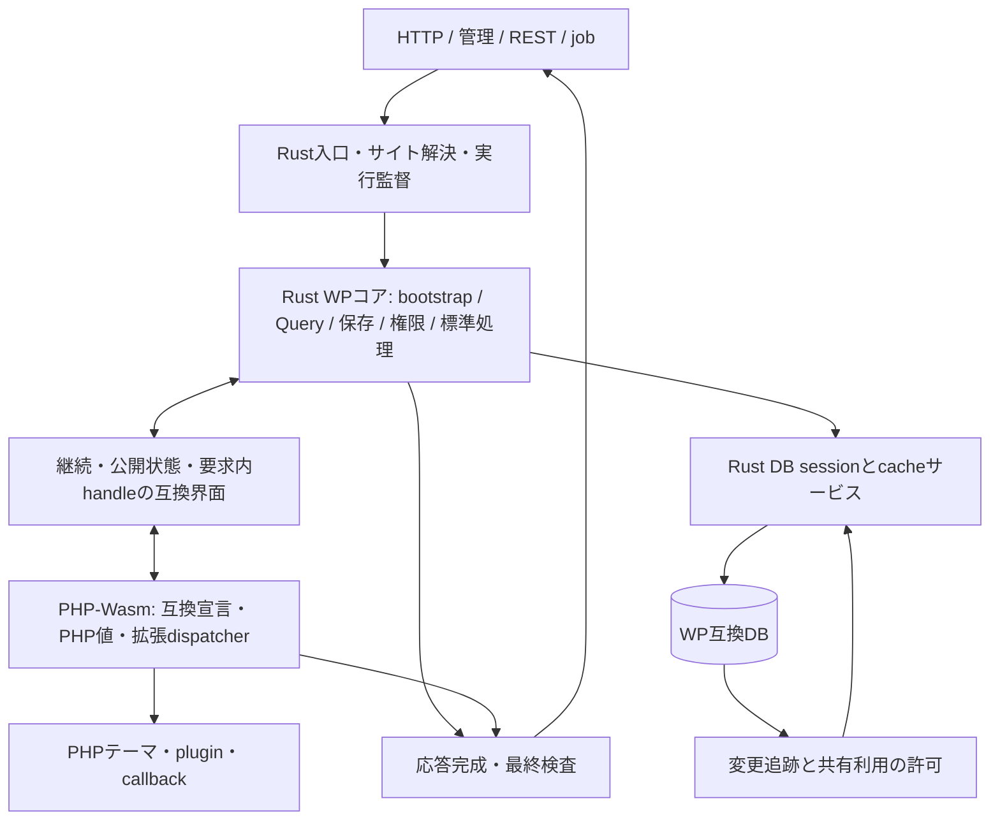
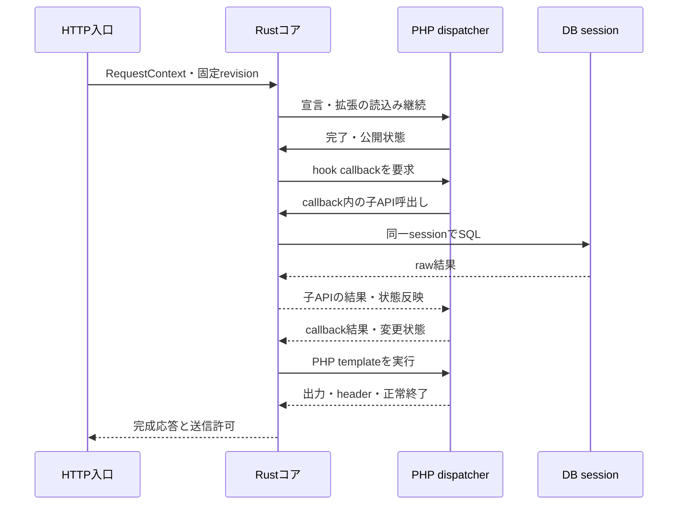

# RecastPress v0.6 基本設計

作成日：2026-11-10（日本時間）。設計版：v0.6。
上位方針：[改訂設計の概要](README.ja.md)。実装上の成立は段階別の試験で確認する。

## 1 全体構成

RustのWPコアが要求の状態機械を持ち、DB・cache・変更追跡へアクセスする。PHPは互換関数・classと拡張コードを保持する。同じ要求の中で、Rustの処理とPHP callbackを交互に実行する。

図の双方向矢印は論理上の往復を示す。hostから実行中のWasm関数へ直接再入する実装は前提にしない。PHPのdispatcherがRustの継続要求を処理し、子のRust呼出しを同じ要求へ入れる。[互換界面詳細](php-compatibility.ja.md)にプロトコルを定める。

## 2 論理コンポーネントと配置

| コンポーネント | 所有する責務 | 外へ渡さないもの |
| --- | --- | --- |
| 公開HTTP／管理HTTP | Host検査、入力限界、サイト・route解決、応答送信 | 任意PHPファイルを実行する権限 |
| 実行監督 | queue、worker、期限・取消し、コード版固定、異常回収 | DB資格情報、管理専有設定 |
| Rust WPコア | 標準処理、operation stack、標準hook位置、権限判断 | 共有lockを保持したcallback呼出し |
| PHP互換実行部 | 宣言、PHP値、callable、public状態、出力buffer | 別要求・別サイトのobject／closure |
| DB session actor | 要求専用の接続・transaction・raw結果・更新結果分類 | 生driver handle・接続資格情報 |
| site共有サービス | cache、epoch、追跡状態、source identity、予算予約 | 未確認snapshotの公開利用 |
| 管理・保守サービス | 設定、コード束、拡張受入、移行、backup、更新 | 通常pluginからの有効版変更 |

公開HTTPと管理HTTPは別processを基本とする。v0.6の初期配置では、実行workerごとにRustコアとPHP-Wasm hostを同じprocessへ置き、DB actorとやり取りする。PHPのtrapや強制回収がHTTP入口・site共有サービスを巻き込まないようにする。workerはサイト・役割・コード版に固定する。

site共有サービスは初期はサイトごとに一つの権威を持つ。別processに置く場合、認証したローカルIPCを使い、site・role・revisionを照合する。通知だけを失効の正本にしない。単一ホスト内の構成を基準とし、複数ホスト化は同じepochと有期限の共有利用許可を保証できたprofileで受け入れる。

Rustコアは公開・管理・REST・cronで同じ標準実装を使う。入口の役割や能力は異なってよいが、異なる権限アルゴリズムや独立したユーザー正本を作らない。

## 3 状態と所有

| 状態 | 正本・所有者 | 同期・破棄の規則 |
| --- | --- | --- |
| 投稿、users、roles、options、meta等 | WP互換DB | Rust標準手順または許可済みwpdb操作で更新。外部変更も追跡 |
| mediaとコード | 管理ファイル／不変コード束 | DBとfileを対応するbackup単位で取得。コードは版切替 |
| PHP object・配列参照・callable | 要求内PHP runtime | request世代付きhandleで関連付ける。共有cacheへhandleを保存しない |
| PHP公開property・globals・hook登録表 | PHP実体 | Rust入口・PHP実行の前後で、各操作が必要とする観測を行う |
| Rust処理の途中状態 | 要求のoperation frame | 子操作開始時に外側をsuspend。再開時に古い公開snapshotを捨てる |
| 認証・認可の標準規則 | Rustコア | PHPのcurrent user表現と拡張filterの変更を、その判定点で反映 |
| 接続・transaction | 要求のDB actor | 入れ子操作も同じsessionを使う。未清掃の接続を再貸出ししない |
| 共有派生データと失効 | site共有サービス | source・epoch・code・schema・codec・追跡の条件で利用 |
| 設定、OIDC連携、実行policy | 本体専有の永続領域 | WP公開globalの書換えを専有設定の変更として受理しない |

PHP実体が正本なのは拡張から観測する可変メモリであり、WPの業務規則や権限根拠まで任意のPHP申告へ委ねる意味ではない。例えば `WP_User` の公開状態が変わったときは対象版の標準動作に従ってRustが評価するが、単なるhandleや `is_admin()` を管理操作の許可証にしない。

## 4 要求ライフサイクル

初期のworkerはコンパイル済みmoduleだけを再利用する。各要求のPHP／WASI instance、globals、hooks、handle表、Rust operation stack、DB session、入出力captureを新設する。v0.5のcompile1回・fresh要求の成果を継承し、同じPHP heapを清掃して再利用する方式は別の受入にする。

この図では外側の処理をcallback待ちで保持し、子のAPIを先に完了させる。PHPとRustが相手の最終完了だけを待つ循環を作らない。取消しは全frame・DB待機・PHP実行へ伝播する。

| 要求状態 | 条件と次の動作 |
| --- | --- |
| Accepted | 検証したroute・code・profile・能力と有限予算を確保 |
| Preparing | fresh環境、DB actor、互換宣言、bootstrap用contextを作る |
| Running | RustとPHPを順序付けて実行。要求内のPHP実行は同時に二つ走らせない |
| Finalizing | WPの終了・shutdown処理、出力buffer、DB・callback結果を確定 |
| ReadyToSend | status・headers・body・revision・epoch・非公開条件を最終検査 |
| Cleaning | handle失効、DB清掃、actor join、instance・一時file・予約を回収 |
| Finished | 応答または固定した失敗と、回収結果を記録 |
| Aborting | callback失敗、期限超過、trap、取消し。成功応答を未確定のまま送らず回収へ |

`exit` 等のWPが使う意図的な要求終了は、未確定のRust frameを中止し、PHP shutdownの観測と応答の検査を経て完了できる経路を持つ。trap・fatalと同じ正常返値にはしない。詳細な結果分類は[互換界面詳細](php-compatibility.ja.md)に従う。

## 5 bootstrapと実装の選択

Rust bootstrapは、固定版から抽出した段階表を順に実行する。互換宣言、定数・globals、MU-plugin、通常plugin、pluggable解決、theme初期化、標準登録とhooksを対象版どおりに配置する。段階表はpluginが任意に並べ替える設定にしない。

各関数・class・methodの実装をmanifestで一意に解決する。

| 実装種別 | 用途 |
| --- | --- |
| RustCore | 標準アルゴリズムをRustへ移植済み。PHP入口からも同じ処理へ入る |
| PhpSurface | 宣言・公開状態・言語操作・拡張実行のみを担う |
| PhpCoreDelegate | 未移植標準処理を版固定のPHP本体へ明示委譲する |
| ThirdPartyRuntime | 元WP同梱の第三者ライブラリ等。由来と用途を別管理する |
| Unavailable | 未提供の標準機能・能力。範囲と理由を表示する |

移植済み実装を元の全体bootstrapと同時に宣言しない。class内の一部methodだけを移行する場合も、一つのclass宣言を生成し、各methodの処理主体を指定する。二つの同名classを読込む構成は作らない。

PHP委譲を使うprofileは要求開始時に固定する。関連する読取り・保存・権限・hookの実装に相互互換の根拠を持たせる。途中の未知条件やエラーで元WP全体を再起動し、同じ操作をやり直さない。未受入のprofileは製品経路へ公開しない。

## 6 標準の処理単位

| 分野 | Rust側のまとまり | PHPとの接点 |
| --- | --- | --- |
| 公開要求 | WP main、rewrite、Query、404・header・template選択 | hooks、公開WP／Query、PHP template |
| 読取り | post、taxonomy、meta、options、users、comments | filter、PHP値の形、class・global |
| 更新 | sanitize、validation、保存順序、標準副作用の起動 | plugin action、serializer、再入した更新 |
| 認証・認可 | credential、session、nonce、capability、失効 | pluggable、authenticate／capability filters |
| block・描画 | parser、標準context・render、theme.json・style | 拡張render callback、shortcode、widget |
| API・管理 | REST標準controller、AJAX、admin操作、cron | plugin route・admin page・job callback |
| 運用 | install、upgrade、移行、backup、一体更新 | plugin activation・upgrade callback、既存UI資産 |

標準hookはRustが元と同じ位置で発火する。callbackの登録名や解除可能性は残す。標準callbackをRustの不可視な直呼出しへ吸収して `remove_filter()` の意味を失わせない。

## 7 DB・キャッシュ・変更追跡

正本DBのWP schema、値、collationとsessionの意味を維持する。Rust Queryが構築しPHP filtersが変更したSQLは、まず通常のDB経路で実行する。内部索引の非対応や共有cacheの停止を理由に、標準Query全体をPHPへ戻さない。

変更追跡が正常な範囲でのみ共有結果を使う。source identity・接続profile・適用位置・未処理イベント・code・epochを利用許可へ結び付ける。監視停止、適用待ち、上限超過、source不明では許可を取り消す。DBが同定できて正常ならRustコアから直読し、DB自体の障害なら失敗を返す。

要求中の変更SQLは、送信前に対象共有経路を抑止する。COMMIT、ROLLBACK、結果不明、外部副作用を区別する。元WPの複数SQL保存を勝手に一括transactionへ変更しない。callbackが更新後に再入したときは同じsessionで最新の要求状態を見る。

応答cacheはcode・profile・設定・epochを含むキーを使い、書込み・個人状態・不明な副作用がある経路を保存しない。ヒットで標準hook・pluginの必要な処理が省略されても正しいことを、profile単位で確認する。

## 8 失敗・隔離・能力

PHP handleは対象要求だけに有効とし、終了・trap・worker喪失で一斉に失効させる。Rustのhost所有権、別サイトのDBやfile、内部制御APIへの権限をPHP値から取得できないようにする。

DB、file、外向きHTTP、mail、時計・乱数、コード読込みを能力として扱う。PHP拡張が共有する環境内の完全な相互隔離は保証しない。サイト・役割・workerを越える到達、専有領域の置換・迂回は実行環境でも拒否する。

| 失敗 | 基本動作 |
| --- | --- |
| catch可能なPHP例外・Error | 同じPHP runtimeへ同じthrowableを返せる場合は伝播。未捕捉なら要求失敗 |
| 意図的な `exit`／終了 | 正常返値のない終端として処理。shutdownと応答条件を照合 |
| trap・fatal・資源超過 | frameを中止しworkerを隔離・回収。途中出力を成功へ変換しない |
| DB結果不明 | 変更を再実行せず共有停止を維持。照合と利用者への結果不明表示 |
| 共有サービス喪失 | 共有経路を停止。正常な正本DBへの通常処理を継続可能にする |
| protocol／handle違反 | 要求をpoisonし、追加操作を受け付けず回収 |

PHPを停止したことと、DB・mail・外部HTTPの副作用が取り消されたことを同一視しない。回収完了前にDB接続・instance・handle世代を次要求へ再利用しない。

## 9 配布・管理と進捗

リリースはRust本体、WP互換定義・loader、同梱資産、PHP-Wasm、host、codec、API・移植profileを一つの組合せとして固定する。WPコアの独立更新で生成宣言やRust実装との対応を崩さない。theme・pluginは別版として検査後にコード束へ組み込む。

標準管理画面の互換操作を提供し、独自機能は追加1画面へまとめる。そこには設定値と実稼働状態、共有停止理由、自動資源配分、実行profile、未移植標準処理の委譲を表示する。通常の導入操作でABI・Wasmビルドを利用者に調整させない。

移植進捗は分野別に、Rust標準実装、PHP委譲、互換表面、未提供を区別する。各代表操作について標準処理のRust実行、PHP callback、標準PHP委譲の回数・理由を記録する。API総数やPHPファイル削減率だけで完成率を出さない。

具体的なモジュール、実行手順、性能測定と配備は[コア詳細](detailed-design.ja.md)、段階ごとの合格条件は[実装・受入](implementation-and-validation.ja.md)に定める。
